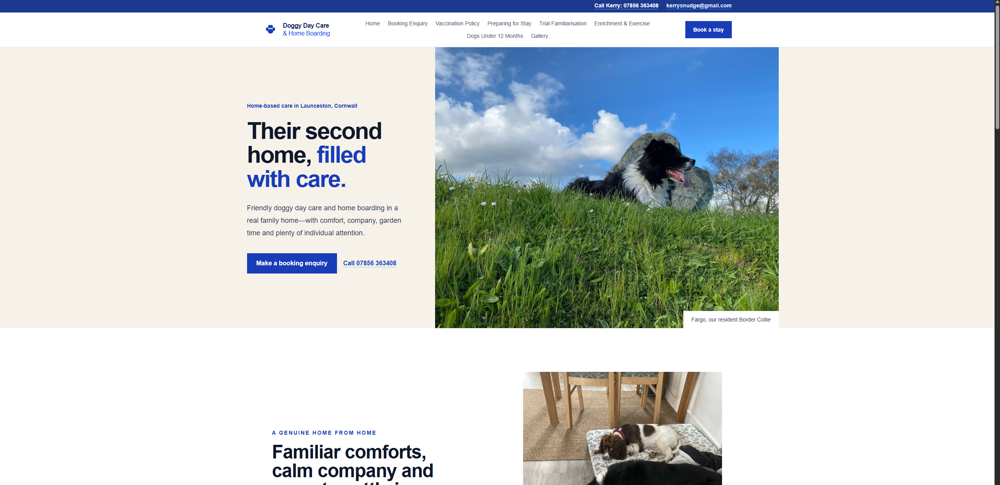
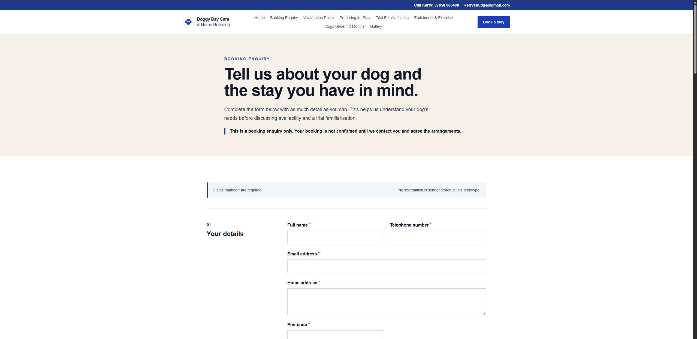

# Doggy Day Care & Home from Home Boarding

Website for an independent dog daycare and home boarding business in Launceston, Cornwall.

**[View the live website](https://www.launcestondogboarding.com/)**

## Implementation

- Next.js 16 App Router, React 19, TypeScript and Tailwind CSS 4.
- Responsive homepage and booking enquiry form with multiple dogs, conditional fields, per-dog permissions, browser validation and a review-before-submit step.
- `POST /api/booking-enquiries` validates submissions server-side with Zod.
- Supabase-hosted PostgreSQL stores enquiries in `booking_enquiries`, `enquiry_dogs` and `dog_permissions`.
- The PostgreSQL RPC `create_booking_enquiry(jsonb)` saves each enquiry atomically. Submission keys provide idempotency: identical retries return the existing enquiry; conflicting reuse is rejected.
- A server-only Supabase client handles persistence. Public database roles cannot access the tables or execute the RPC.
- Resend sends business notification emails only for newly created enquiries. Email failure does not roll back persistence. Dedicated medical, microchip and insurance fields are excluded from notifications; booking notes are included.
- Public API safeguards include honeypot protection, a 64 KiB request body limit, JSON content-type validation and Origin checking.
- The frontend and API are deployed on Vercel; the database is hosted on Supabase.
- Development-only autofill helpers support manual form testing.
- A single-owner admin interface uses Supabase Auth for login/logout, protected enquiry lists/details and status changes. See [admin setup](docs/admin-setup.md) for account and environment configuration.

Submissions are enquiries only and do not confirm a booking. Some navigation links point to information pages that are not yet implemented.

## Routes

| Route | Purpose |
| --- | --- |
| `/` | Homepage, services and contact information |
| `/booking-enquiry` | Booking enquiry form |
| `POST /api/booking-enquiries` | Validate and persist an enquiry, then attempt email notification |
| `/admin/login` | Owner login |
| `/admin/enquiries` | Protected enquiry list |
| `/admin/enquiries/[id]` | Protected enquiry detail and status changes |

## Running locally

Use Node.js 20 or later and npm. Copy `.env.example` to `.env.local` and configure the listed server environment variables for Supabase, Resend, notification addresses and allowed origins. Keep credentials out of version control.

```bash
npm install
npm run dev
```

Open [http://localhost:3000](http://localhost:3000). Localhost origins are accepted in development.

```bash
npm run lint
npm run build
npm start
```

## Testing and CI

Run the automated test suites locally with:

```bash
npm test
npm run test:booking
npm run test:admin
```

`npm test` runs all booking-system and admin tests. The focused commands run
only the Vitest booking suite or the Node.js admin authorisation suite.

Database persistence is covered separately by the transactional SQL suite at
`supabase/tests/booking_persistence_tests.sql`. Run the complete file manually
in the Supabase SQL Editor after applying migrations `001` and `002`. It verifies
one-dog and two-dog inserts, rollback on failure, idempotent retries, conflicting
submission keys, and denied public RPC access. Its final `ROLLBACK` removes all
fictional test records.

GitHub Actions runs on every push to `main` and every pull request targeting
`main`. It installs the locked dependencies with `npm ci`, then runs the full
test suite, lint checks, and a production build. The workflow does not deploy or
require production service credentials.

## Key files

| Path | Purpose |
| --- | --- |
| `components/booking-enquiry-form.tsx` | Form, review, submission and development helpers |
| `lib/serialize-booking-enquiry.ts` | Structured payload and conditional-field nulling |
| `lib/booking-enquiry-schema.ts` | Server-side Zod validation |
| `app/api/booking-enquiries/route.ts` | API safeguards and submission handling |
| `lib/supabase-server.ts` | Server-only Supabase client |
| `lib/booking-email.ts` | Resend notifications |
| `supabase/migrations/` | Database schema and atomic persistence RPC |

## Screenshots

[](https://www.launcestondogboarding.com/)

[](https://www.launcestondogboarding.com/booking-enquiry)
