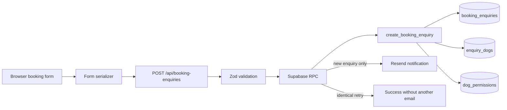
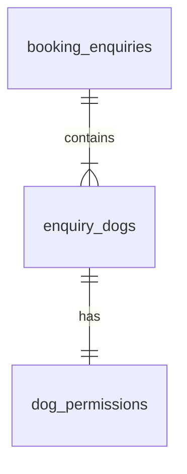

# System architecture

## 1. System overview

This project is a small, production-deployed booking enquiry system for an
independent dog daycare and home boarding business. It uses:

- Next.js 16 App Router, React 19 and TypeScript for the public website, booking
  form, Route Handler and server-rendered admin interface.
- Zod at the public API boundary and when validating admin inputs and database
  results.
- Supabase PostgreSQL for durable booking enquiry storage.
- Supabase Auth for the single-owner admin login and cookie-backed session.
- Resend for operational email notifications after successful persistence.
- Vercel for application hosting.

The database is the source of truth. A submitted form creates an unconfirmed
enquiry with a database-generated `NEW` status; it does not confirm a booking.

## 2. Public booking data flow

1. The React form holds its interactive state, including multiple dogs and
   conditional fields.
2. `lib/serialize-booking-enquiry.ts` converts the form data into the nested API
   payload. It trims text, preserves dog order, removes temporary UI IDs, nulls
   service-specific fields, and nulls details for inactive conditional fields.
3. The browser sends JSON to `POST /api/booking-enquiries` with a client-generated
   UUID submission key.
4. The Route Handler applies request safeguards and validates the complete
   payload with `lib/booking-enquiry-schema.ts`.
5. The server-only Supabase client invokes
   `create_booking_enquiry(payload jsonb)` using the service-role key.
6. PostgreSQL writes the enquiry, its dogs and each dog's permissions as one
   atomic operation.
7. Only when the RPC reports `was_created = true` does the server attempt a
   Resend notification. The API then returns a safe response to the browser.

## 3. Database model

The schema stores each enquiry as a historical snapshot rather than maintaining
customer accounts or reusable dog profiles.

### `booking_enquiries`

The parent record contains owner contact details, service and date information,
booking notes, confirmations, status, timestamps, the unique `submission_key`,
and the submission payload hash. Its UUID, initial `NEW` status and timestamps
are generated by PostgreSQL rather than accepted from the public client.

### `enquiry_dogs`

Each row is one dog included in an enquiry. It contains identity, insurance,
veterinary and treatment dates, health conditions, routines and behaviour
information. `enquiry_id` references `booking_enquiries.id`, while `position`
preserves the order in which dogs were submitted. The pair
`(enquiry_id, position)` is unique.

### `dog_permissions`

This table contains the care permissions and acknowledgements for one dog. Its
`dog_id` is both its primary key and a foreign key to `enquiry_dogs.id`, making
the relationship exactly one permission row per dog in the persistence flow.

Deleting a `booking_enquiries` row cascades to its `enquiry_dogs` rows, and
deleting a dog cascades to its `dog_permissions` row. Separating parent booking
data, repeatable dog records and per-dog permissions avoids duplicating owner and
booking fields while keeping medical, care and consent data associated with the
correct dog.

## 4. Atomic persistence and idempotency

`create_booking_enquiry(jsonb)` is a PostgreSQL `SECURITY INVOKER` function that
is executable only by `service_role`. One RPC call inserts the parent, loops over
the ordered dog array, and inserts one permission row for every dog. PostgreSQL
executes the function call atomically: if any insert, cast or constraint fails,
the whole statement fails and none of its parent, dog or permission rows remain.

Every submission includes a UUID `submission_key`, which has a unique database
constraint. The function hashes the canonical JSONB payload with SHA-256 and
stores that fingerprint with the enquiry:

- An unused key creates the complete enquiry and returns its UUID with
  `was_created = true`.
- An identical retry returns the existing UUID with `was_created = false` and
  creates no duplicate rows.
- Reusing the key with different payload content raises a controlled uniqueness
  conflict, which the API maps to HTTP 409.
- A conflict-safe second lookup handles concurrent requests using the same key.

Email is attempted only after the RPC has returned a newly created enquiry. An
identical retry therefore cannot trigger a duplicate notification; the Resend
request also uses the enquiry UUID as its email idempotency key.

## 5. Trust boundaries and security model

All browser input is untrusted. Browser validation improves usability, but the
server independently checks the entire nested payload with a strict Zod schema,
including dog-count limits, service/date rules, conditional details, crate
agreement and required confirmations. PostgreSQL types and `CHECK` constraints
provide a further integrity layer.

The public Route Handler also enforces:

- an allowed `Origin` list, with localhost exceptions only in development;
- an exact JSON content type;
- a 64 KiB request-body limit, checked while streaming as well as through the
  declared content length;
- a honeypot header that returns a neutral response without validation,
  persistence or email delivery;
- safe client errors and server logs that do not expose raw database errors,
  full customer payloads, stack traces or secrets.

`SUPABASE_SERVICE_ROLE_KEY` is imported only through a module marked
`server-only` and is never exposed through a `NEXT_PUBLIC_` variable. Public
browser roles have no direct table access: Row Level Security is enabled, table
privileges are revoked from `public`, `anon` and `authenticated`, and those roles
cannot execute the persistence RPC. Only trusted server code uses the
service-role client.

## 6. Admin architecture

The admin area uses Supabase Auth email/password authentication with a
per-request server client. Access and refresh tokens are held in HTTP-only,
SameSite=Lax cookies scoped to `/admin`; production cookies are Secure. The
Next.js proxy refreshes Auth state for admin requests and applies private,
no-store cache headers.

`requireAdmin()` is the data-access guard. It validates `ADMIN_USER_ID`, asks
Supabase Auth for the current user, and permits access only when that verified
user UUID matches the configured owner UUID. Each enquiry list read, detail read
and status mutation calls this guard independently before obtaining the
service-role database client. Protected layouts add an earlier user-facing
redirect, but are not relied upon as the data authorization boundary.

After authorization, server code uses the service-role client to read enquiries
or update only the validated status and timestamp. This is a deliberate
application-layer boundary because service-role access bypasses RLS. For the
current single-owner MVP, a single allowlisted Auth UUID is simple and adequate;
there is no registration flow, role hierarchy or browser database client.

## 7. Email failure behaviour

Successful database persistence remains authoritative. Resend is a secondary
notification mechanism, so a delivery, timeout or configuration failure is
logged safely and does not delete or roll back the enquiry. The customer still
receives the successful persistence response.

The email contains the enquiry ID, customer contact details, service, requested
dates and times, dog count and names, and optional booking notes. Detailed
medical information, microchip numbers and insurance details are intentionally
excluded and remain available only through the protected admin system.

## 8. Testing and CI

The normal automated suite contains 51 tests and requires no live Supabase or
Resend credentials:

- 41 Vitest tests cover booking payload validation, serialization, API outcomes,
  idempotency-related behaviour, email triggering/failure and safe email content.
- 10 Node.js tests cover admin authorization, login, guarded reads and status
  mutations with external boundaries mocked.
- `supabase/tests/booking_persistence_tests.sql` separately exercises the real
  PostgreSQL function and relationships transactionally, ending with `ROLLBACK`
  so fictional records are not retained.

GitHub Actions runs for pushes to `main` and pull requests targeting `main`. Its
single Node.js 24 job uses npm caching and runs `npm ci`, `npm test`,
`npm run lint` and `npm run build`. It performs verification only and contains
no deployment step or production credentials.

## 9. Deployment and configuration

Vercel hosts the Next.js application. Supabase hosts PostgreSQL and Auth, while
Resend delivers notification emails. No real values belong in source control.

### Configuration and public-class values

| Variable | Purpose |
| --- | --- |
| `SUPABASE_URL` | Supabase project endpoint. |
| `SUPABASE_PUBLISHABLE_KEY` | Public-class Supabase key used by the server-side, cookie-aware Auth client. It is not a service-role key. |
| `ADMIN_USER_ID` | UUID allowlist entry for the single owner; used only in server authorization. |
| `BOOKING_ALLOWED_ORIGINS` | Comma-separated production origins accepted by the booking API. |
| `BOOKING_NOTIFICATION_EMAIL` | Operational recipient for new-enquiry notifications. |
| `BOOKING_FROM_EMAIL` | Verified sender identity used by Resend. |

### Server secrets

| Variable | Purpose |
| --- | --- |
| `SUPABASE_SERVICE_ROLE_KEY` | Privileged server-only database access used after validation or admin authorization. |
| `RESEND_API_KEY` | Server-only credential for notification delivery. |

None of these variables is exposed through a `NEXT_PUBLIC_` name in the current
implementation. `.env.local` is ignored for local development, while production
values are configured in Vercel.

## 10. Key design decisions and trade-offs

- **Server-side trust boundary:** duplicated validation across browser UX, Zod
  and database constraints costs some maintenance but prevents trust in editable
  client state.
- **RPC-based atomic persistence:** keeping the multi-table write in PostgreSQL
  guarantees all-or-nothing storage without a partially saved enquiry.
- **Idempotency:** a unique key and payload hash make retries safe while rejecting
  accidental reuse for changed content.
- **Persistence before email:** accepting a stored enquiry despite a notification
  outage prioritises durable customer data over a secondary delivery channel.
- **Guard before service-role access:** the small admin layer can use privileged
  database access safely only because every operation authenticates and
  allowlists the owner first.
- **Deliberately small MVP:** historical enquiry snapshots, one owner, four
  statuses and no customer accounts keep the system understandable while meeting
  the business's present workflow.
